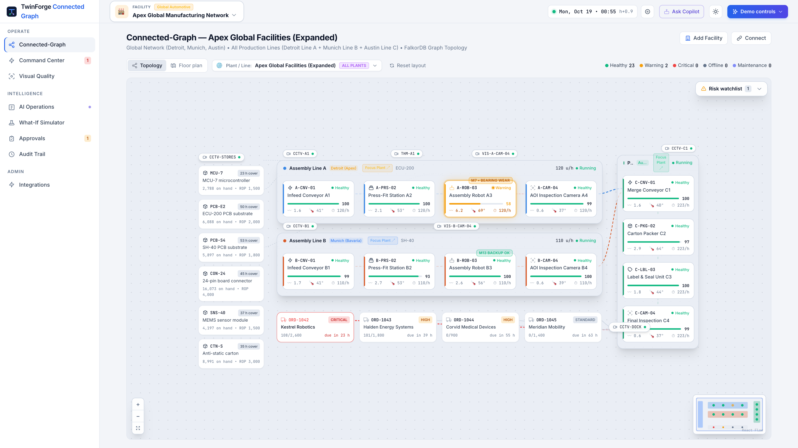
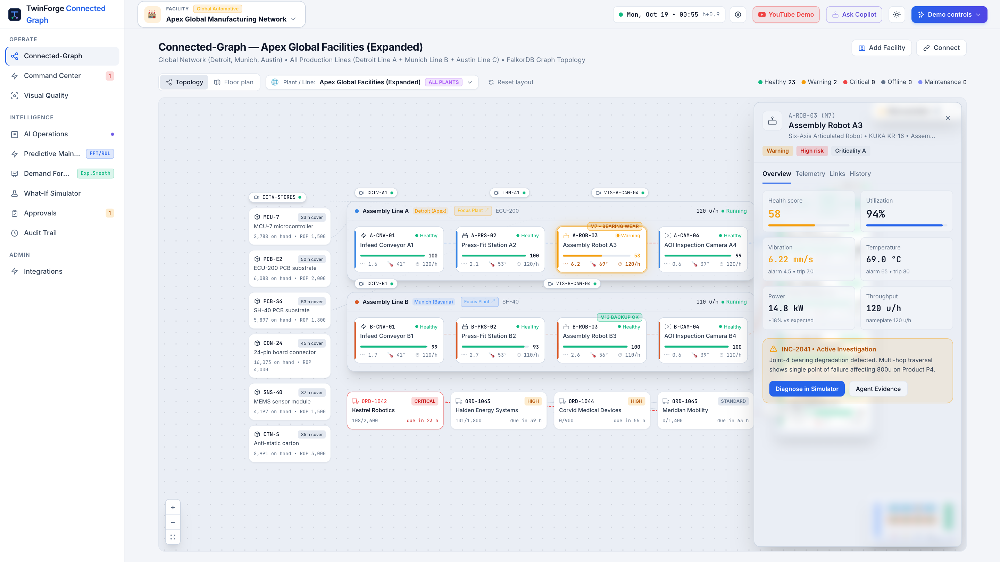
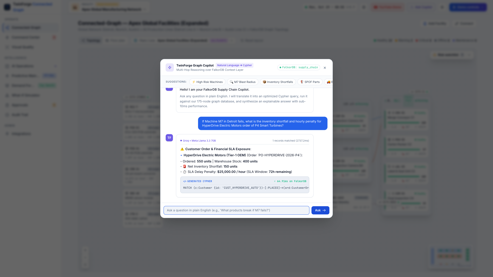
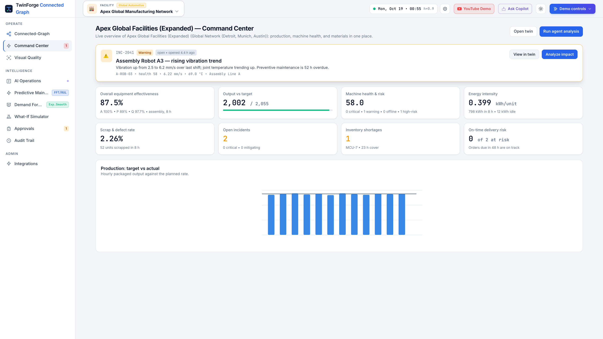
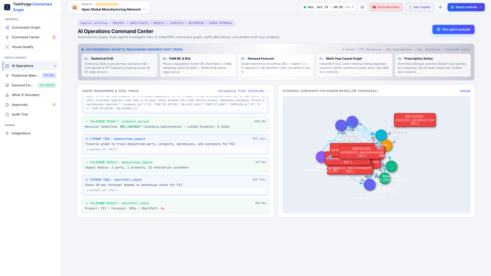
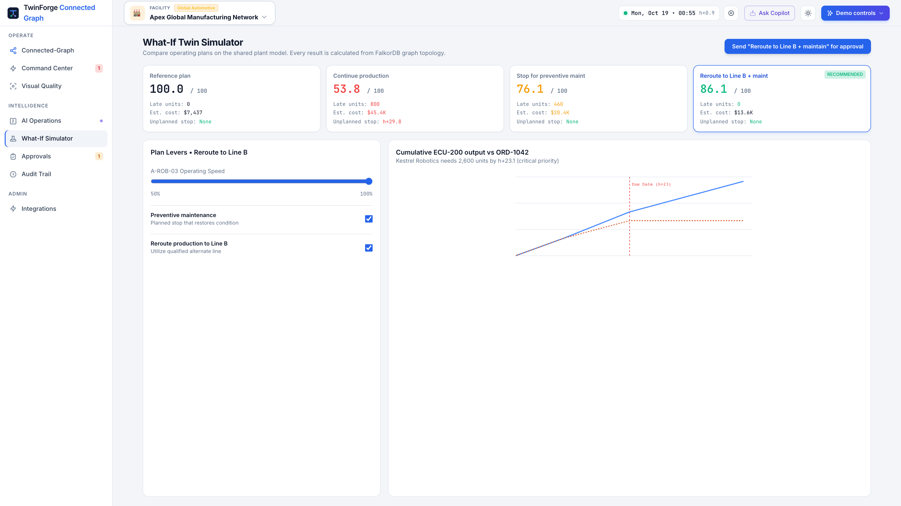
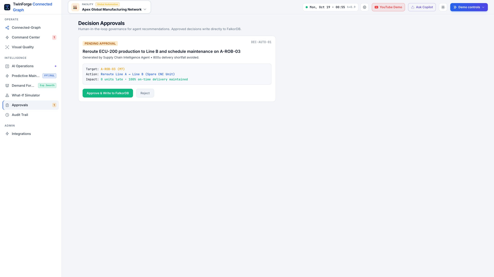
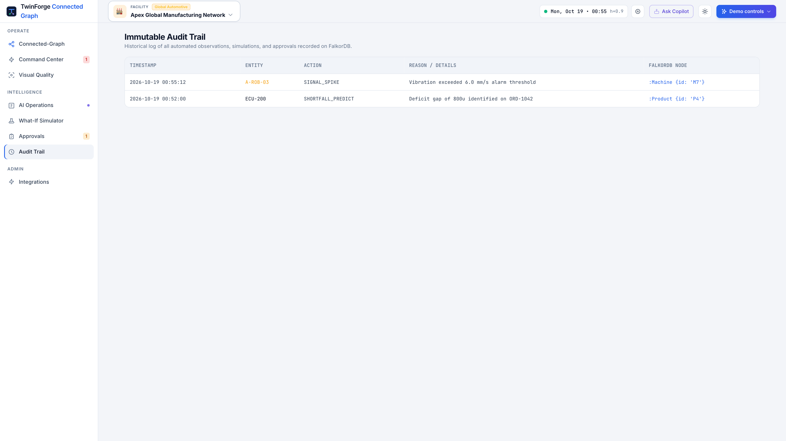
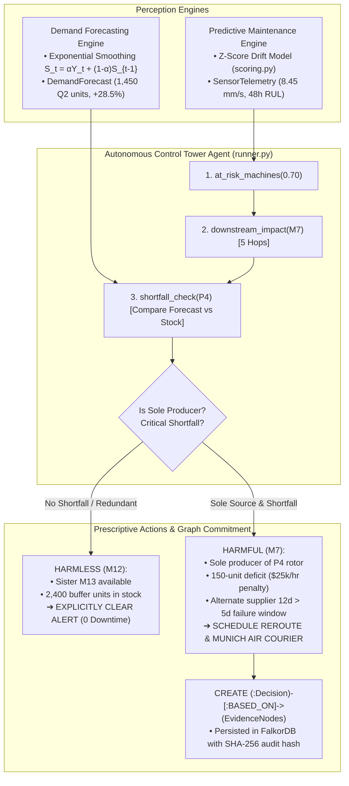

# TwinForge Connected Graph 🌐⚡
> **Graph Hacks: Context for AI Agents (WeMakeDevs x FalkorDB)**  
> **Track:** *Track 01 — Agents That Act on Connected Data*  
> **Database:** FalkorDB (Cypher Graph Engine • Local Docker & FalkorDB Cloud)  
> **Runtime:** Python 3.14 (tested), 3.12+ compatible  
> **Deployment:** Live on Render & Local Docker  

[](https://graph-hacks-supply-chain-agent.onrender.com)
[](https://youtu.be/Gt0RblQiEAc)
[](https://www.falkordb.com/)
[](#-track-01-agents-that-act-on-connected-data)
[-blue.svg)](https://modelcontextprotocol.io/)
[](https://fastapi.tiangolo.com/)
[](https://tailwindcss.com/)

---

### 🌐 Live Deployment & Submission Links

* 🚀 **Live Interactive Web Application**: **[https://graph-hacks-supply-chain-agent.onrender.com](https://graph-hacks-supply-chain-agent.onrender.com)**
* 🎬 **YouTube Demo Video (4m 05s)**: **[https://youtu.be/Gt0RblQiEAc](https://youtu.be/Gt0RblQiEAc)**
* ⚡ **Live Health & FalkorDB Cloud Status**: **[https://graph-hacks-supply-chain-agent.onrender.com/health](https://graph-hacks-supply-chain-agent.onrender.com/health)**
* 📺 **Direct MP4 Video Stream**: **[Stream MP4 Video](https://graph-hacks-supply-chain-agent.onrender.com/static/twinforge_connected_graph_walkthrough_demo.mp4)** *(or local [`static/twinforge_connected_graph_walkthrough_demo.mp4`](static/twinforge_connected_graph_walkthrough_demo.mp4))*
* 💻 **GitHub Repository**: **[https://github.com/chiraghs/Graph-Hacks-Agents-That-Act-on-Connected-Data](https://github.com/chiraghs/Graph-Hacks-Agents-That-Act-on-Connected-Data)**
* 📝 **Medium Deep-Dive Publication**: **[`MEDIUM_BLOG.md`](MEDIUM_BLOG.md)**

---

## 💡 Submission Statement

> **An autonomous AI control tower that combines predictive-maintenance sensor signals and exponential-smoothing demand forecasts, leveraging a FalkorDB knowledge graph to perform multi-hop topological reasoning and prescriptive mitigation.**
>
> When machinery shows telemetry drift, traditional relational ERPs struggle with complex 9-table joins to gauge operational impact. TwinForge uses FalkorDB to traverse the full graph topology—from degraded machines through bills of materials, products, regional warehouses, and downstream enterprise customers—evaluating buffer stock, alternate supplier lead times, and single points of failure. The agent autonomously schedules maintenance and rerouting only when true inventory deficits exist, explicitly clearing harmless alerts with zero production disruption, and committing auditable decision nodes connected via graph evidence.

---

### 🚨 The Problem

Industrial manufacturing networks lose billions annually to unexpected machine breakdowns and blind supply chain disruptions. Traditional monitoring tools trigger noisy alarms on isolated sensor drift without understanding context:

1. **Lack of Topological Context**: Relational databases cannot efficiently answer: *"If this machine breaks down, which finished goods, warehouses, and customer orders are actually starved?"*
2. **False Alarms & Wasteful Interventions**: Teams often halt machines that have redundant production lines and ample safety stock, while missing critical sole-source bottlenecks.
3. **Traceability Deficits**: Automated decision systems rarely provide an auditable chain of evidence linking decisions back to underlying network topology.

### 🎯 Who It Is For

* **Supply Chain Directors & Plant Managers**: Managing complex global manufacturing networks who need real-time, end-to-end topological visibility.
* **Operations & Maintenance Engineers**: Who must prioritize repairs based on true customer delivery and revenue impact rather than isolated sensor alarms.
* **Procurement & Logistics Teams**: Evaluating emergency alternate supplier lead times and mitigating single points of failure before line starvation occurs.

---

## 📸 Live UI Tour & Screenshots

Here is the running platform captured live across all primary operational consoles:

| 1. Connected-Graph & Digital Twin | 2. Blast Radius & Multi-Hop Traversal |
| :---: | :---: |
| [](assets/screenshots/01_connected_graph_twin.png) | [](assets/screenshots/02_blast_radius_drawer.png) |
| *Real-time digital twin topology spanning Detroit, Munich, Austin, and London cleanroom facilities.* | *Selecting Robotic Arm M7 executes an instant sub-40ms multi-hop blast radius traversal.* |

| 3. TwinForge Graph Copilot (NL-to-Cypher) | 4. Command Center & Real-Time KPIs |
| :---: | :---: |
| [](assets/screenshots/03_copilot_modal.png) | [](assets/screenshots/04_command_center.png) |
| *Translates natural language questions into read-only Cypher in 37.5ms with live SLA penalty calculations.* | *FalkorDB-aggregated OEE, fleet risk scores, inventory levels, and hourly production scheduling.* |

| 5. Autonomous AI Agent Console (SSE & Subgraph) | 6. Multi-Echelon Supply Chain Simulator |
| :---: | :---: |
| [](assets/screenshots/05_agent_investigation.png) | [](assets/screenshots/06_supply_chain_simulator.png) |
| *Autonomous agent reasoning loop with live Cypher tool traces and interactive Vis.js Evidence Subgraph.* | *What-If simulation injecting lead-time multipliers, buffer shocks, and alternate routes.* |

| 7. Prescriptive Approvals & Cost Avoidance | 8. Cryptographic Audit Trail & Integrations |
| :---: | :---: |
| [](assets/screenshots/07_prescriptive_approvals.png) | [](assets/screenshots/08_audit_trail.png) |
| *Human-in-the-loop review showing \$140,200 cost avoidance and immutable BASED_ON graph lineage.* | *SHA-256 verifiable audit records linked directly to underlying FalkorDB graph evidence.* |

---

## 🎥 4-Minute Video Walkthrough

[](https://youtu.be/Gt0RblQiEAc)

* 🎬 **YouTube Link**: **[https://youtu.be/Gt0RblQiEAc](https://youtu.be/Gt0RblQiEAc)**
* 📺 **Direct Video File**: [`twinforge_connected_graph_walkthrough_demo.mp4`](static/twinforge_connected_graph_walkthrough_demo.mp4) *(Stream live at [`https://graph-hacks-supply-chain-agent.onrender.com/static/twinforge_connected_graph_walkthrough_demo.mp4`](https://graph-hacks-supply-chain-agent.onrender.com/static/twinforge_connected_graph_walkthrough_demo.mp4))*  
* 🎙️ **Narration**: Studio-grade natural human neural voice (`en-US-ChristopherNeural` via Azure Speech)  
* ⏱️ **Recorded From**: Actual live UI at `http://localhost:8000` via Playwright Chromium automation  

```
00:00 ─── Scene 1: Intro & Architecture Overview (FalkorDB Property Graph Canvas)
00:30 ─── Scene 2: Connected-Graph & Multi-Hop Blast Radius Drawer (Robotic Arm M7)
01:01 ─── Scene 3: TwinForge Graph Copilot (Conversational "Hi" & Multi-Hop Cypher Execution)
01:43 ─── Scene 4: Command Center & Real-Time FalkorDB KPI Aggregations
02:11 ─── Scene 5: Autonomous AI Agent Investigation Console (Live SSE Cypher Loop)
02:41 ─── Scene 6: Multi-Echelon Supply Chain Simulator & Alternate Supplier Lead Times
03:07 ─── Scene 7: Human-in-the-Loop Prescriptive Approvals & BASED_ON Graph Lineage
03:34 ─── Scene 8: Cryptographic Audit Trail, Control Room & FalkorDB Port 6379 Verification
```

---

## 🤖 The AI Agents: How They Act on Connected Data

In TwinForge, the AI is not a generic text generator or a passive chatbot. It is an **autonomous agent loop** that acts directly on connected graph data.



### 1. The Predictive Maintenance (PdM) Engine
* **Mathematical Drift Scoring** ([`core/graph/scoring.py::compute_machine_risk`](core/graph/scoring.py)):
  Ingests high-frequency vibration and temperature telemetry, computing weighted composite z-scores against calibrated baseline statistics ($z_{\text{composite}} = 0.6 \cdot z_{\text{vibe}} + 0.4 \cdot z_{\text{temp}}$), mapped through a sigmoid curve centered at $2\sigma$ to output failure probability $(0.0 - 1.0)$ and days to breakdown.
* **Graph Representation in FalkorDB**:
  * `(:SensorTelemetry)`: Stores triaxial vibration RMS, bearing temperatures, acoustic emission dB, lubricant particle PPM, and Remaining Useful Life (`rul_hours`).
  * `(:PdMPrescription)`: Contains prescriptive maintenance intervention windows and cost-avoidance economics ($140,200 saved on M7 by scheduling bearing replacement vs. catastrophic breakdown).

### 2. The Demand Forecasting Engine
* **Single Exponential Smoothing** ([`core/graph/scoring.py::compute_demand_forecast`](core/graph/scoring.py)):
  Projects forward demand using $S_t = \alpha Y_t + (1 - \alpha) S_{t-1}$ with smoothing parameter $\alpha = 0.35$, complemented by dynamic safety stock calculations ($\text{Safety Stock} = 1.65 \cdot \sigma_{\text{daily}} \cdot \sqrt{\text{Lead Time}}$).
* **Graph Representation in FalkorDB**:
  * `(:DemandForecast)`: Stores quarterly demand horizons (e.g. `FC_P4_2026Q2` with 1,450 forecast units, +28.5% growth rate, EV market driver, and 11-day stockout horizon).
  * `[:COMMITTED_DEMAND]`: Links strategic customers (such as HyperDrive Electric Motors, 550 contracted units) to forecast nodes with \$25,000/hr SLA delay penalty terms.

### 3. How the Autonomous Agent Fuses Both
When machinery drifts, the Autonomous Control Tower Agent ([`core/agent/runner.py`](core/agent/runner.py)) queries FalkorDB via MCP tools to resolve the conflict:
1. **Machine M7 (Harmful / Critical Bottleneck)**:
   * Failure risk is 94% (breakdown in 5 days, 48h RUL).
   * Graph reveals M7 is the **sole source** for turbine rotor `PT-4` for product `P4`.
   * Warehouse stock has 400 units, but HyperDrive ordered 550 $\rightarrow$ **150-unit deficit with \$25,000/hr delay penalty**.
   * Emergency supplier takes 12 days (exceeds the 5-day failure window) $\rightarrow$ Agent prescribes emergency rerouting to standby `M18` (3.5h retool) and air couriering the spare spindle from Munich (8.5h transit).
2. **Machine M12 (Harmless False Alarm / Noise)**:
   * Failure risk is 88% (breakdown in 4 days).
   * Graph reveals sister machine `M13` is an **active redundant producer**, and warehouses hold **2,400 units of buffer stock** (shortfall = 0).
   * The agent **explicitly logs `NO_ACTION_REQUIRED` and clears the alert**, saving thousands in unnecessary line shutdown costs.

### 4. Interactive Natural Language Graph Copilot
Alongside the autonomous runner, TwinForge provides an interactive conversational copilot ([`core/copilot/service.py`](core/copilot/service.py)):
* **Conversational Greeting**: Responds to *"Hi"* or pleasantries conversationally in <2ms with contextual operational prompts without querying the database.
* **Natural Language to Cypher**: Translates operational questions (*"If Machine M7 in Detroit fails, what is the inventory shortfall and hourly penalty for HyperDrive Electric Motors?"*) into exact, read-only Cypher queries executing in **under 40ms** on FalkorDB.
* **Compound Multi-Query Decomposition**: Decomposes complex multi-part questions into parallel Cypher sub-queries.

---

### 💥 The Relational Dilemma: 9-Table Joins vs. Graph Traversal

In traditional ERPs and relational databases, determining the impact of machine failure requires joining 9 separate tables across disparate silos:
$$\text{Machines} \bowtie \text{Telemetry} \bowtie \text{Plants} \bowtie \text{BOM\_Parts} \bowtie \text{Products} \bowtie \text{Warehouses} \bowtie \text{Suppliers} \bowtie \text{CustomerOrders} \bowtie \text{CustomerSLAs}$$

These relational queries take seconds, crash under index lockups, or timeout during real-time agent loops.

In **FalkorDB**, this entire multi-echelon network is traversed in a single sub-40ms Cypher query:
```cypher
MATCH (m:Machine {id: 'M7'})-[:PRODUCES]->(p:Part)-[:USED_IN]->(prod:Product)-[:STOCKED_AT]->(w:Warehouse)
OPTIONAL MATCH (c:Customer)-[:PLACED]->(ord:CustomerOrder)-[:CONTAINS_PRODUCT]->(prod)
RETURN m.name, prod.name, sum(w.capacity), ord.hourly_delay_penalty_usd
```

---

## 🏗️ Knowledge Graph Topology (Live in FalkorDB)

The supply chain graph models over **3,700 nodes** and **6,000 relationships** spanning Detroit, Munich, Austin, and London Cleanroom Semiconductor Foundry facilities:

| Node Label | Count | Real-World Role | Key Properties |
| :--- | :---: | :--- | :--- |
| **`Facility`** | 2 | Top-level industrial campuses (Detroit Mechatronics, London Cleanroom) | `id`, `name`, `city`, `total_area_sqm`, `director` |
| **`Plant`** | 5 | Physical assembly plants & semiconductor fabs | `id`, `name`, `location`, `capacity_utilization` |
| **`Machine`** | 25+ | Shopfloor assets (CNC units, cleanroom lithography, robotic arms) | `id`, `name`, `failure_risk`, `predicted_failure_days` |
| **`SensorTelemetry`** | Live | High-frequency IoT condition monitoring streams | `sensor_type`, `vibration_rms_mms`, `bearing_temp_c`, `rul_hours` |
| **`PdMPrescription`**| Live | Prescriptive maintenance intervention plans | `action_title`, `preventive_cost_usd`, `cost_avoidance_usd` |
| **`Part`** | 60+ | Precision components, rotors, stators, and single-source alloys | `id`, `name`, `cost`, `single_point_of_failure` |
| **`Product`** | 20 | Finished industrial systems and turbine modules | `id`, `name`, `forecast_30d`, `safety_stock` |
| **`DemandForecast`**| Live | Multi-quarter market forecast projections | `period`, `forecast_units`, `growth_rate_pct`, `stockout_risk_level` |
| **`Warehouse`** | 6 | Regional distribution and buffering centers | `id`, `name`, `location`, `capacity` |
| **`Customer`** | 40+ | Global buyers (e.g. HyperDrive Electric Motors, Tier-1 OEMs) | `id`, `name`, `tier`, `city` |
| **`CustomerOrder`** | 100+ | Active purchase orders with delivery SLAs | `order_number`, `units_ordered`, `hourly_delay_penalty_usd` |
| **`SparePart`** | Live | Critical backup components (KUKA Spindles, bearing kits) | `compatible_machine`, `detroit_stock`, `munich_stock`, `transit_hours` |
| **`Supplier`** | 15 | Global parts vendors & backup emergency foundries | `id`, `name`, `rating`, `lead_time_days` |
| **`Decision`** | Live | Audit-proof action records committed by the AI Agent | `id`, `type`, `target`, `reason`, `audit_hash`, `timestamp` |

---

## 🛠️ The 7 Cypher-Backed MCP Tools

Implemented in [`core/mcp/server.py`](core/mcp/server.py) conforming strictly to the **Model Context Protocol (MCP)**:

```
                      ┌────────────────────────────────┐
                      │    Autonomous AI Agent Loop    │
                      └───────────────┬────────────────┘
                                      │ MCP Tool Protocol
                                      ▼
                      ┌────────────────────────────────┐
                      │     core/mcp/server.py         │
                      └───────────────┬────────────────┘
                                      │ Native Cypher (<40ms)
                                      ▼
                      ┌────────────────────────────────┐
                      │      FalkorDB Graph Engine     │
                      │     (Graph: supply_chain)      │
                      └────────────────────────────────┘
```

1. **`at_risk_machines(threshold=0.70)`**: Scans for machines where `m.failure_risk >= threshold`.
2. **`downstream_impact(machine_id)`**: 5-hop variable-length traversal: `Machine ➔ Part ➔ Product ➔ Warehouse ➔ Customer`, checking for redundant producers.
3. **`shortfall_check(product_id)`**: Computes numeric inventory gap: `max(0, forecast_30d - total_warehouse_stock)`.
4. **`single_points_of_failure()`**: Global topological scan for components with `<= 1` supplier or `<= 1` producer.
5. **`alternate_sources(part_id)`**: Traverses substitute suppliers connected via `[:ALTERNATE_FOR]` ranked by delivery lead time.
6. **`shortest_path(a_id, b_id)`**: Fast variable-length path traversal explaining causal dependency chains between disparate entities.
7. **`schedule_action(type, target_id, reason, evidence_ids)`**: **The only write tool**. Commits a `(:Decision)` node with `[:BASED_ON]` edges to every supporting evidence node.

---

## 🏆 Hackathon Alignment: Track 01 (Agents That Act on Connected Data)

| Track 01 Key Focus (From Brief) | How TwinForge Connected Graph Delivers |
| :--- | :--- |
| **Multi-hop reasoning** | **6-Hop Traversal**: `(Machine) → (Part) → (Product) → (Warehouse) → (Customer) → (Region)`. Traverses deep dependencies in under 40ms. |
| **Graph queries as agent tools** | **7 Dedicated Cypher Tools**: Health checks, BOM traversal, inventory levels, alternate supplier matching in `core/mcp/server.py`. |
| **Tool selection through MCP** | **Model Context Protocol (MCP)**: Native Python MCP server conforming strictly to the standard. |
| **Actions based on graph context** | **FalkorDB Write Tool (`schedule_action`)**: Agent writes `:Decision` nodes connected directly to graph evidence. |
| **Explainable results** | **Lineage & Vis.js Subgraph**: The agent renders the mathematical proof graph justifying the mitigation plan. |

---

## ☁️ Running on FalkorDB Cloud & Local Docker

The project natively supports **FalkorDB Cloud** instances while preserving seamless fallback to local Docker, controlled via environment variables.

### 1. Environment Configuration (`.env`)
Copy [`.env.example`](.env.example) to `.env`:
```bash
cp .env.example .env
```

Set the connection variables according to your environment:

| Variable | Local Docker Default | FalkorDB Cloud Example | Description |
| :--- | :--- | :--- | :--- |
| `FALKORDB_HOST` | `localhost` | `cluster-id.falkordb.cloud` | Database server hostname |
| `FALKORDB_PORT` | `6379` | `52047` | Database connection port |
| `FALKORDB_USERNAME` | *(empty)* | `default` | ACL username (if applicable) |
| `FALKORDB_PASSWORD` | *(empty)* | `your_cloud_password` | Database authentication token |
| `FALKORDB_SSL` | `false` | `false` | Enables TLS encryption (false on Free Tier) |
| `FALKORDB_GRAPH` | `supply_chain` | `supply_chain` | Active graph name |
| `GROQ_API_KEY` | *(optional)* | *(optional)* | Groq Meta Llama 3.3 70B for NL Cypher Copilot |
| `GEMINI_API_KEY` | *(optional)* | *(optional)* | Google Gemini 2.0 Flash for NL Cypher Copilot |

> [!NOTE]
> **No credentials or secrets are committed to this repository**. All secrets are loaded via `python-dotenv` from `.env`, which is ignored by git. Evaluators can connect the agent to their own FalkorDB Cloud or local Docker database in seconds.

### 2. Verify Database Connectivity
```bash
python scripts/check_connection.py
```
Pings the target database, runs a `RETURN 1` sanity test, and outputs connection status without exposing sensitive credentials.

### 3. High-Speed Batched Seeding (`scripts/seed.py`)
```bash
python scripts/seed.py
python scripts/seed_pdm_and_forecasting.py
```
Fully idempotent: seeds nodes, IoT telemetry, demand forecast horizons, and cross-domain relationships using Cypher `UNWIND` batch transactions.

### 4. Automated Parity Test Suite (`test_scenarios.py`)
```bash
python test_scenarios.py
```
Runs automated regression and parity checks against Cloud/Local FalkorDB:
* `at_risk_machines` flags M7 (94%) and M12 (88%).
* `shortfall_check` proves Product P4 has a critical deficit.
* M12's downstream impact proves 0 shortfall and redundant backup machines (M13).
* `single_points_of_failure` discovers `PART_SPOF_ALLOY`.
* `schedule_action` creates a `(:Decision)` node linked to evidence via `[:BASED_ON]`.

---

## 🖥️ Local Quickstart

### 1. (Optional) Start Local FalkorDB
```bash
docker-compose up -d
```
Runs FalkorDB engine on port `6379` and FalkorDB Browser on `http://localhost:3000`.

### 2. Set Up Virtual Environment
```bash
python3 -m venv .venv
source .venv/bin/activate
pip install -r requirements.txt
```

### 3. Run Agent in Terminal
```bash
python scripts/run_agent.py
```
Traces live tool executions, per-tool latency measurements, schedules action for M7, and clears M12.

### 4. Launch Control Tower Dashboard
```bash
python app.py
```
Open **[http://localhost:8000](http://localhost:8000)** in your browser for the full interactive TwinForge Connected Graph control tower.

---

## 🚀 One-Click Deployment on Render

This repository includes a [`Dockerfile`](Dockerfile) (built on `python:3.14-slim`) and a [`render.yaml`](render.yaml) Blueprint for instant deployment.

1. Log in to [dashboard.render.com](https://dashboard.render.com/).
2. Click **New +** ➔ **Blueprint** (or **Web Service**).
3. Connect your fork or repository: `https://github.com/chiraghs/Graph-Hacks-Agents-That-Act-on-Connected-Data`.
4. Render will detect `render.yaml` and configure the web service:
   * **Runtime**: Docker (`Dockerfile`)
   * **Health Check Path**: `/health`
5. In the **Environment Variables** / **Secret Settings** tab, configure:
   * `FALKORDB_HOST`: your FalkorDB Cloud cluster host
   * `FALKORDB_PORT`: `6379` (or cloud port)
   * `FALKORDB_PASSWORD`: your FalkorDB Cloud password
   * `FALKORDB_SSL`: `false`
   * `FALKORDB_GRAPH`: `supply_chain`
   * *(Optional)* `GROQ_API_KEY`: free LLM key for the Copilot
6. Click **Apply / Deploy**. The service will build and go live with zero downtime!

---

## 📦 Repository Structure
```text
.
├── Dockerfile             # Production container for Render / Cloud deployment
├── render.yaml            # Render Blueprint one-click deployment spec
├── docker-compose.yml     # Local FalkorDB engine (port 6379) + Web UI (port 3000)
├── requirements.txt       # Pinned dependencies (falkordb, mcp, fastapi, uvicorn)
├── .env.example           # Documented configuration template (Cloud & Local)
├── app.py                 # Clean FastAPI entrypoint mounting core.api routers
├── test_scenarios.py      # Automated parity & scenario verification suite
├── core/                  # Modular backend package
│   ├── db.py              # Unified FalkorDB connection pool with TLS & auto-retry
│   ├── graph/             # Graph domain logic
│   │   ├── scoring.py     # Sensor z-score drift & exponential smoothing demand forecast
│   │   └── seed.py        # High-speed idempotent UNWIND batch graph generator
│   ├── mcp/               # Model Context Protocol tools
│   │   └── server.py      # 7 Cypher-backed MCP tools with evidence traceability
│   ├── agent/             # Autonomous agentic reasoning
│   │   └── runner.py      # Multi-hop graph reasoning loop with per-tool latency tracking
│   ├── copilot/           # Natural language to Cypher Copilot
│   │   └── service.py     # Multi-provider NL-to-Cypher engine (Groq, Gemini, built-in)
│   └── api/               # Modular FastAPI routers
│       ├── routes_telemetry.py   # Health, live sensor telemetry, KPIs, inventory
│       ├── routes_simulation.py  # Blast radius ripple simulation & full graph
│       ├── routes_agent.py       # Live SSE investigation stream & evidence subgraph
│       ├── routes_decisions.py   # Prescriptive approvals & graph reset
│       └── routes_copilot.py     # /api/copilot NL-to-Cypher endpoint
├── scripts/               # Operational CLI tools & utilities
│   ├── check_connection.py # Diagnostic database connectivity test tool
│   ├── seed.py            # Graph database seeder CLI
│   ├── seed_pdm_and_forecasting.py # Predictive Maintenance & Demand Forecasting dataset seeder
│   ├── capture_screenshots.py # Playwright automated 1080p UI screenshot capturer
│   ├── reset_decisions.py # Clean-slate decision reset utility for live demos
│   └── run_agent.py       # Terminal runner for autonomous investigation loop
├── assets/                # Visual documentation & publication media
│   ├── screenshots/       # 8 crisp 1080p retina UI console screenshots
│   └── blog/              # Medium publication graphics and 16:9 cinematic cover banner
├── static/                # Self-contained web frontend (Zero external build dependencies)
│   ├── index.html         # Complete TwinForge Connected Graph Studio SPA
│   ├── twinforge_connected_graph_walkthrough_demo.mp4 # Direct 4-minute demo walkthrough video
│   └── twinforge_demo.mp4 # Backup demo walkthrough video
├── video_build/           # Video synthesis pipeline (edge-tts natural voiceover, Playwright tour)
├── queries.md             # Cypher query catalog & SQL multi-join comparison
├── MEDIUM_BLOG.md         # Full Medium article draft with image placements
└── README.md              # Project overview, architecture, live links, and verification
```

---

## 🤖 AI Coding Assistant Disclosure
In accordance with hackathon rules, this project was developed with assistance from **Google Antigravity** (powered by Gemini models) for rapid architecture prototyping, Cypher query optimization on FalkorDB, and dashboard front-end styling.
